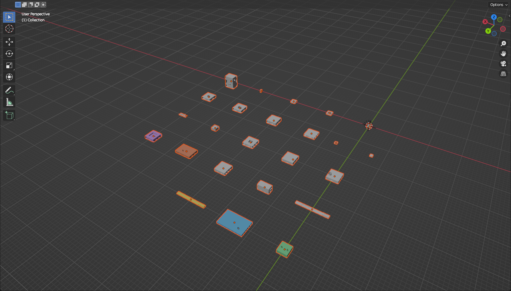
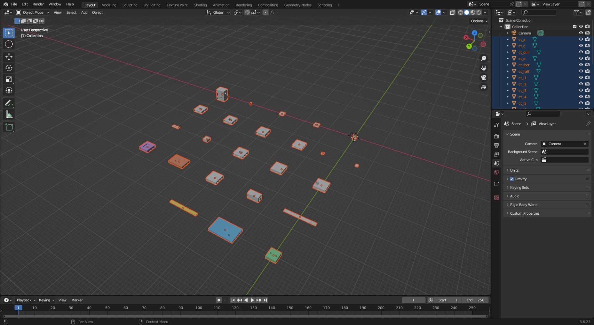

# check-tools: every tool, called directly, against a volume worked out by hand

- **When:** 2026-11-21 14:53:19
- **Why this round:** Close three defects found while testing: (1) a hole in the void answered OK (the volume comparison was too tight for floating point), (2) a hole exactly tangent to a face gave a bad mesh, (3) there were no side holes (parallel to X and to Y) for parts that stand up.
- **What changed since the previous round:** drill_hole refuses a hole that does not touch the part (relative threshold 1e-6) and warns about one that only grazes it; the cutter is nudged by 0.02% when the boolean gives a bad mesh; new tools drill_hole_x and drill_hole_y; segments configurable by environment (default 64, cap 256); new tests: pad and pocket land on the real surface, rectangles with no size, and 8 limit cases with coplanar faces.
- **Code under test:** commit `96b702eeb2` PARTS-RESULTS.md: round R11, Qwen3-0.6B fails all five cases of the strict check (+ 8 uncommitted file(s), diff sha256 `4fcfbd5d5e80`)
- **Blender:** 3.6.23 | **Host:** Intel(R) Core(TM) i5-3317U CPU @ 1.70GHz
- **Result:** 52 passed, 0 failed

## Visual proof

`scene.blend` is the scene itself: open it in Blender to look at the parts.

## Files

`output.txt` (what the test printed), `evidence.json` (every call and measurement, with the hashes of the files), `prompt.txt` (the system prompt), `scene.blend`, `window.png`, `viewport.png`.
