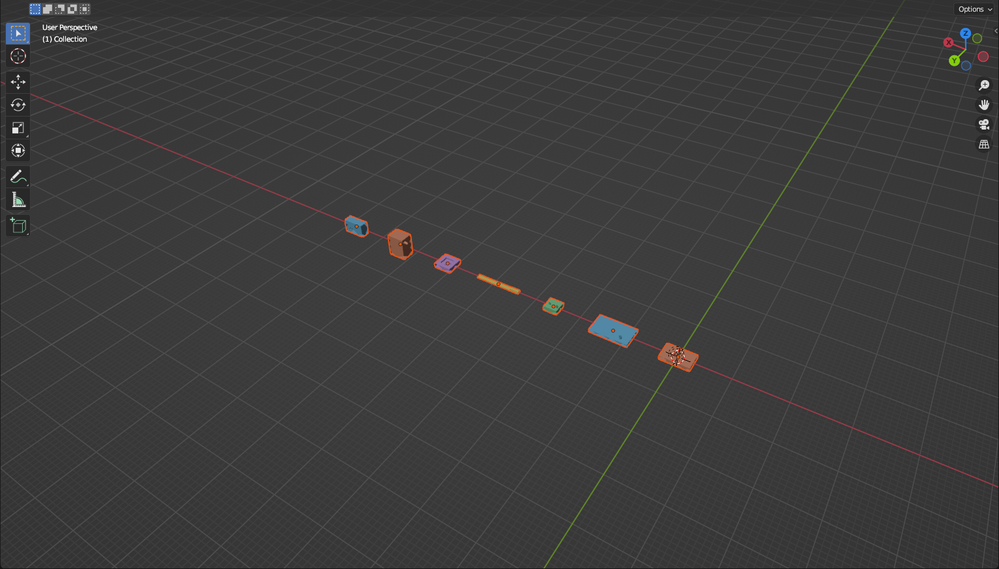
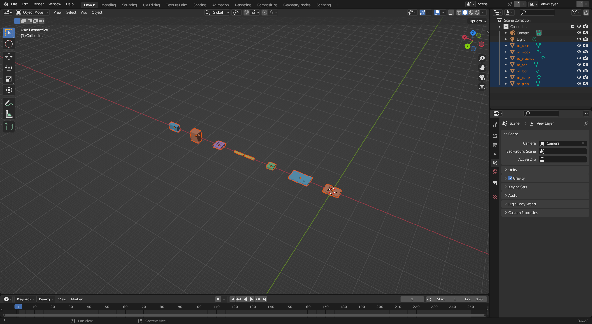

# qwen3-1.7B-q8-f16-furos-laterais

- **When:** 2026-11-21 15:08:36
- **Why this round:** The parts job needs holes on the side of a part that stands up (a foot, an ear). drill_hole had axis and side hidden from the small model, so it could only drill along Z. Two tools with the axis in the NAME (drill_hole_x, drill_hole_y) were added; this round checks that the 1.7B uses them correctly and that the five earlier cases still pass with the longer prompt.
- **What changed since the previous round:** 11 tools instead of 9 (drill_hole_x, drill_hole_y); two new cases (side hole along X on a 40x30x50 foot, along Y on a 50x20x30 ear); prompt lists the two tools and rule 5 names them; create_box has no position (box always at the origin); drill_hole refuses a hole in the void; blender-minor build with the relative no-op threshold.
- **Code under test:** commit `96b702eeb2` PARTS-RESULTS.md: round R11, Qwen3-0.6B fails all five cases of the strict check (+ 11 uncommitted file(s), diff sha256 `a6c221f030df`)
- **Blender:** 3.6.23 | **Host:** Intel(R) Core(TM) i5-3317U CPU @ 1.70GHz
- **Result:** 7 passed, 0 failed, 0 skipped

Compared with `20261121-143937-qwen3-1.7B-q8-f16-tudo-na-origem` (5 passed, 0 failed):

| case | before | now | volume before | volume now |
|---|---|---|---|---|
| box + M3 hole | PASS | PASS | 19127.483 | 19127.483 |
| box + 5 mm hole | PASS | PASS | 23882.3794 | 23882.3794 |
| box + 2 holes | PASS | PASS | 8749.0761 | 8749.0761 |
| pad (raise a strip) | PASS | PASS | 2320.0 | 2320.0 |
| pocket (cut a recess) | PASS | PASS | 14800.0 | 14800.0 |
| side hole along X (a foot) | - | PASS | None | 58870.8426 |
| side hole along Y (an ear) | - | PASS | None | 29607.9314 |

## Visual proof

`scene.blend` is the scene itself: open it in Blender to look at the parts.

## Files

`output.txt` (what the test printed), `evidence.json` (every call and measurement, with the hashes of the files), `prompt.txt` (the system prompt), `scene.blend`, `window.png`, `viewport.png`.
